# Hướng dẫn sử dụng bản web

Hướng dẫn này dành cho quản lý trung tâm và gia sư. Màn hình, nút bấm chỉ hiện theo quyền của tài khoản; các thao tác dưới đây dùng trên bản web, không phải phần mềm WinForms. Web kết nối CSDL riêng `QuanLyGiaSu_Web`.

## 1. Đăng nhập và đổi mật khẩu

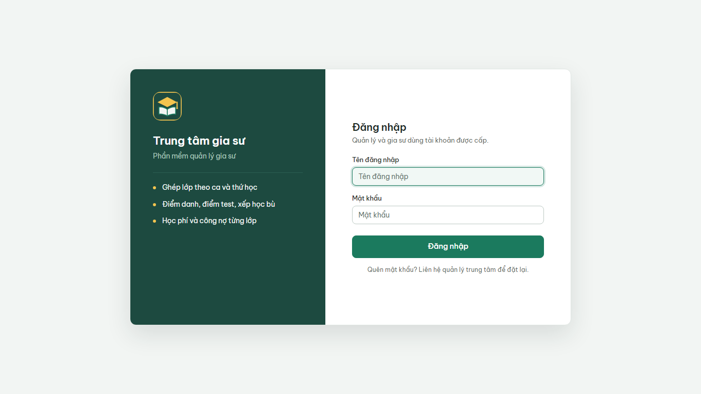

1. Mở địa chỉ web do trung tâm cung cấp. Nếu dùng ngay trên máy cài web, địa chỉ mặc định là `http://localhost:5080`.
2. Nhập tên đăng nhập và mật khẩu do quản lý cấp, rồi chọn **Đăng nhập**.
3. Nếu CSDL mới chưa có tài khoản, đăng nhập lần đầu bằng `admin` / `admin123` và làm theo yêu cầu đặt mật khẩu mới. Đây chỉ là mật khẩu khởi tạo; không dùng lại mật khẩu này cho nơi khác.
4. Muốn đổi mật khẩu sau này, mở menu tên tài khoản ở cuối thanh bên, chọn **Đổi mật khẩu**, nhập mật khẩu hiện tại và mật khẩu mới hai lần, rồi lưu.

Mật khẩu mới dài 6–100 ký tự và phải khác mật khẩu hiện tại. Sau 5 lần nhập sai liên tiếp, đăng nhập tạm khóa trong 5 phút. Nếu quên mật khẩu, liên hệ quản lý để đặt lại; gia sư không tự đặt lại được.

## 2. Màn hình dành cho Quản lý

### Tổng quan và Hôm nay

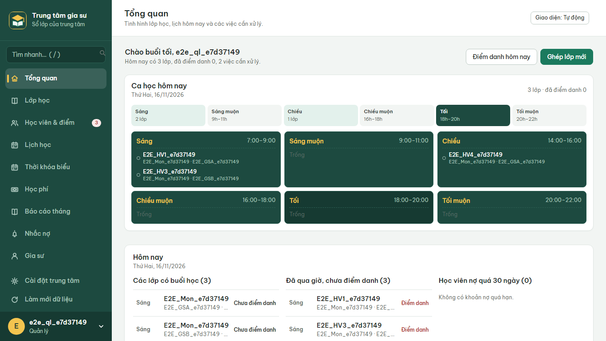

**Dùng để:** xem nhanh số lớp, số học viên, tiền học phí đã thu/còn nợ, lớp trong ngày và việc cần xử lý.

**Cách dùng:** vào **Tổng quan** sau khi đăng nhập. Chọn một ca hoặc lớp trong phần **Ca học hôm nay / Hôm nay** để mở điểm danh đúng ngày, ca; chọn một việc trong **Cần xử lý** để tới màn hình liên quan. Kéo xuống dưới để xem biểu đồ hoạt động và các lớp sắp kết thúc.

**Lưu ý:** phần Hôm nay nêu rõ lớp đã/chưa điểm danh và các khoản nợ quá 30 ngày. Các biểu đồ và số liệu được tính từ CSDL web đang dùng.

### Gia sư

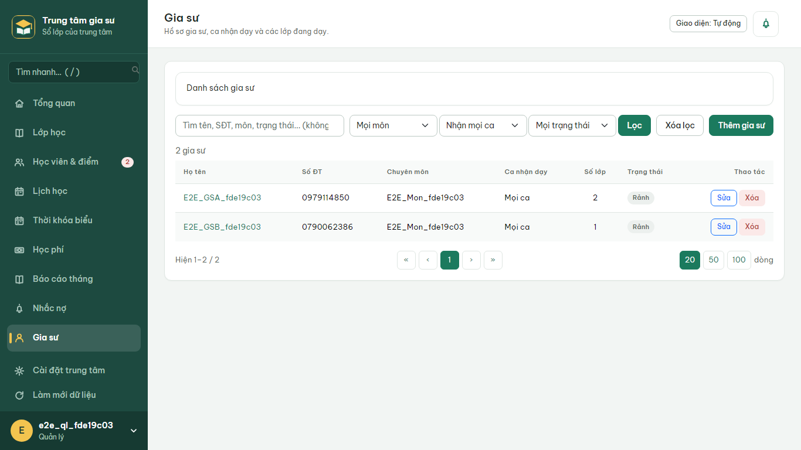

**Dùng để:** quản lý hồ sơ, chuyên môn, ca nhận dạy và trạng thái gia sư.

**Cách dùng:** vào **Gia sư**; nhập từ khóa hoặc lọc theo môn, ca, trạng thái rồi chọn **Lọc**. Chọn tên để xem hồ sơ, **Sửa** để cập nhật, hoặc **Thêm gia sư** để tạo hồ sơ mới.

**Lưu ý:** số điện thoại không được trùng. Trạng thái dạy/bận/rảnh được xác định theo lịch; quản lý có thể đặt **Tạm nghỉ**. Không thể xóa gia sư đang có lớp hoặc có lịch sử dạy; khi gia sư nghỉ, dùng trạng thái **Tạm nghỉ** thay vì xóa.

### Học viên và kết quả học tập

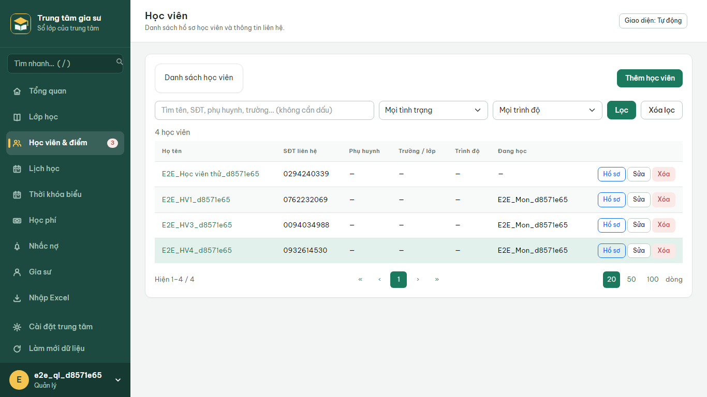

**Dùng để:** lưu thông tin liên hệ, phụ huynh, trường/lớp và xem học viên đang học môn nào.

**Cách dùng:** vào **Học viên & điểm** (hoặc **Học viên** trong các liên kết), tìm theo tên, số điện thoại, phụ huynh hoặc trường; có thể lọc theo tình trạng và trình độ. Chọn tên để mở hồ sơ, rồi chọn **Xem kết quả** để xem điểm, nhận xét, buổi vắng và học bù.

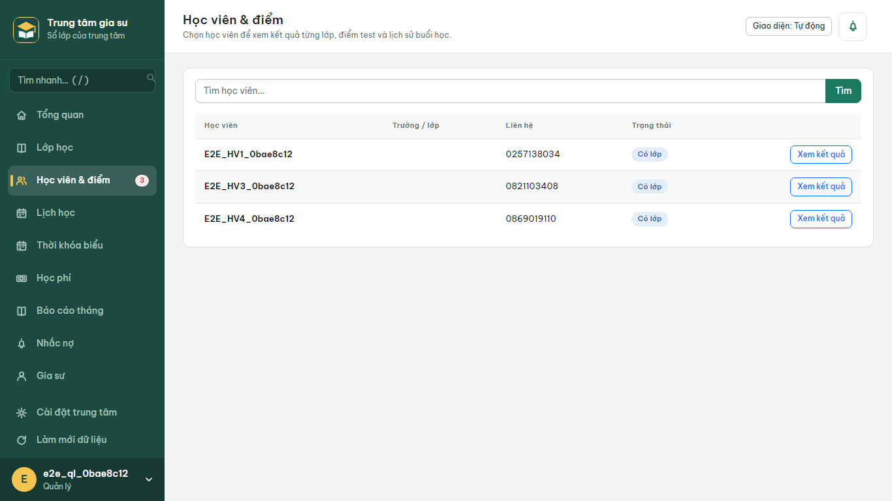

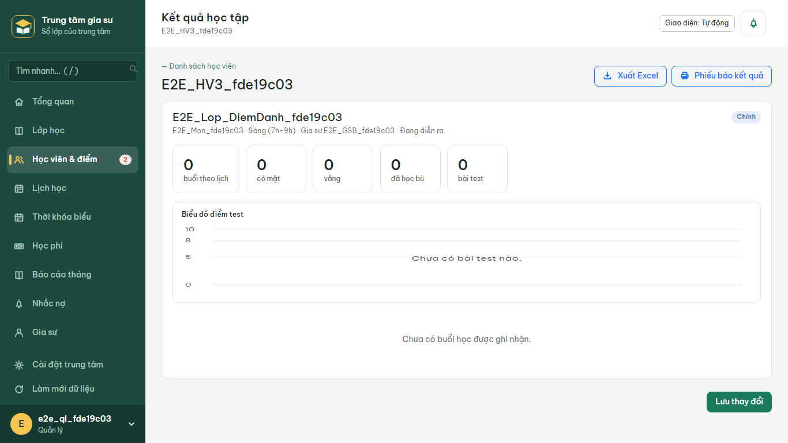

Quản lý có thể thêm, sửa hồ sơ. Gia sư chỉ xem học viên thuộc lớp mình hoặc buổi học bù mình dạy; không sửa hồ sơ. Học viên cần có ít nhất một số điện thoại (của học viên hoặc phụ huynh). Không xóa học viên đã có lớp hoạt động hoặc có lịch sử lớp.

### Tài khoản

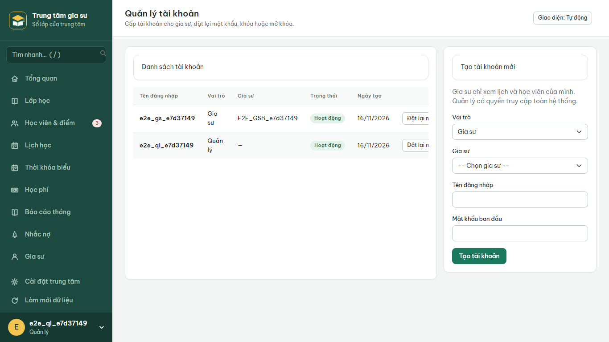

Quản lý vào **Tài khoản** để tạo tài khoản quản lý/gia sư, đặt lại mật khẩu hoặc khóa/mở tài khoản. Khi tạo tài khoản gia sư, chọn hồ sơ gia sư tương ứng; mỗi gia sư chỉ gắn một tài khoản. Không thể khóa tài khoản của chính mình hoặc khóa quản lý đang hoạt động cuối cùng. Gia sư liên hệ quản lý nếu không đăng nhập được.

### Lớp học, ghép lớp và môn học

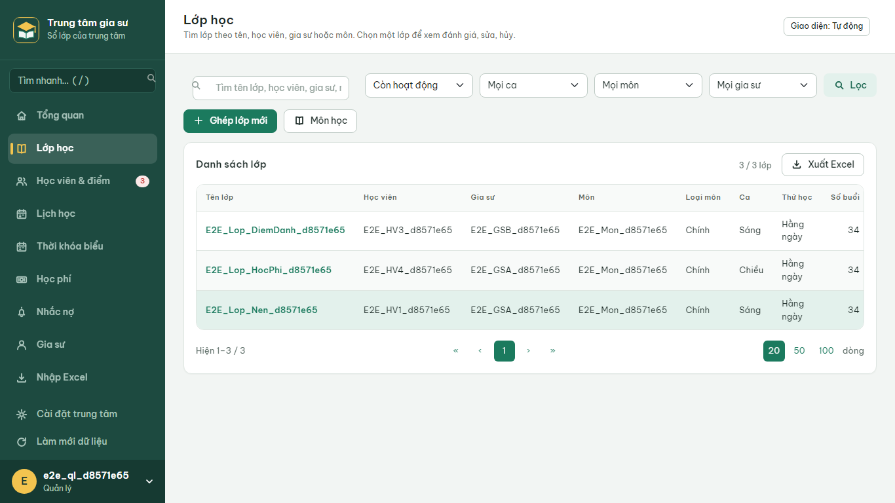

**Dùng để:** tìm lớp, xem tiến độ/đánh giá và tạo, sửa, hủy lớp.

**Cách ghép lớp:** vào **Lớp học** → **Ghép lớp mới**; chọn học viên, môn, ca, thứ học, ngày bắt đầu/kết thúc, học phí và gia sư. Xem thông báo kiểm tra lịch ngay trên biểu mẫu; nhập hoặc giữ tên lớp được gợi ý; chọn **Ghép lớp** để lưu. Danh sách lớp có thể lọc theo từ khóa, trạng thái, ca, môn và gia sư; chọn tên lớp để xem chi tiết.

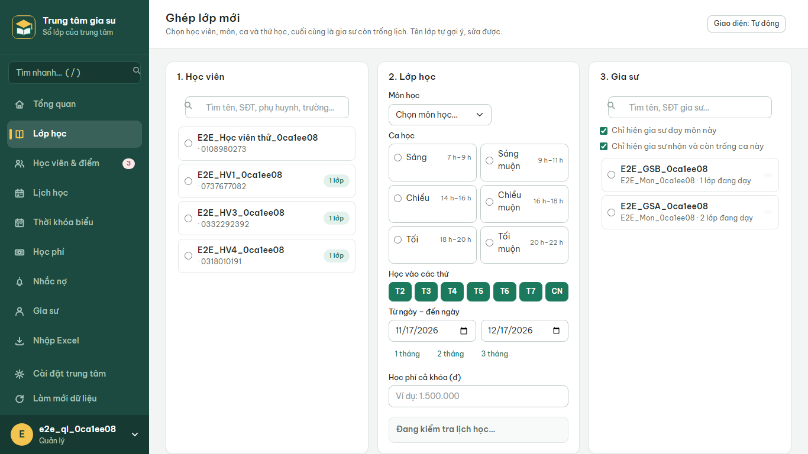

**Quy tắc cần nhớ:** mỗi lớp kèm một học viên với một gia sư; chọn ít nhất một thứ và khoảng ngày phải có buổi học. Ngày bắt đầu không ở quá khứ, học phí lớn hơn 0 và không quá 100 triệu đồng. Hệ thống chặn trùng ca/ngày học của học viên hoặc gia sư và trùng môn với cùng gia sư. Gia sư **Tạm nghỉ** không nhận lớp mới. Cảnh báo gia sư không nhận ca đã chọn không tự chặn ghép lớp.

Khi sửa lớp, ca và ngày bắt đầu không đổi; học phí mới không thấp hơn số đã đóng và ngày kết thúc không trước buổi đã điểm danh gần nhất. **Hủy lớp** giữ lịch sử và xóa các buổi bù trong tương lai; chỉ xóa hẳn lớp khi chưa có điểm danh hoặc lần đóng tiền. Lớp bị hủy không chiếm lịch.

Để quản lý danh mục môn, từ trang **Lớp học** chọn **Môn học**:

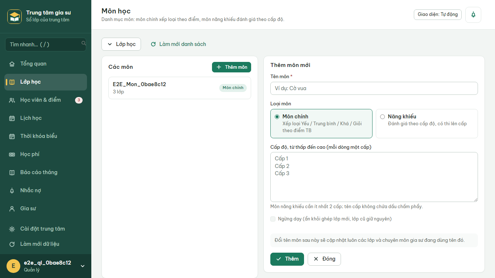

Chọn loại **Môn chính** để đánh giá theo điểm trung bình, hoặc **Năng khiếu** để khai báo tối thiểu hai cấp độ theo thứ tự. Môn đang có lớp không xóa được; chọn **Ngừng dạy** để ẩn khỏi ghép lớp mới. Đổi tên môn sẽ cập nhật tên đang dùng ở lớp và chuyên môn gia sư.

### Lịch học và Thời khóa biểu

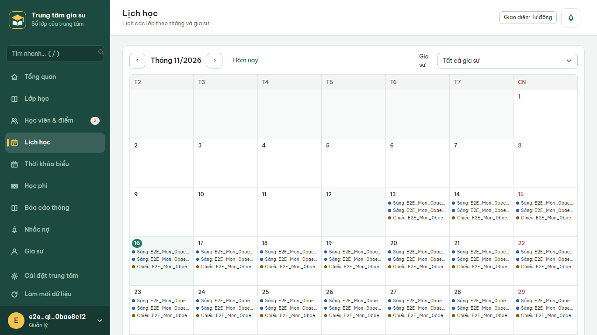

**Lịch học** hiển thị lớp trên lịch tháng. Chọn mũi tên để chuyển tháng, chọn một ngày để xem các lớp trong ngày; quản lý có thể lọc theo gia sư.

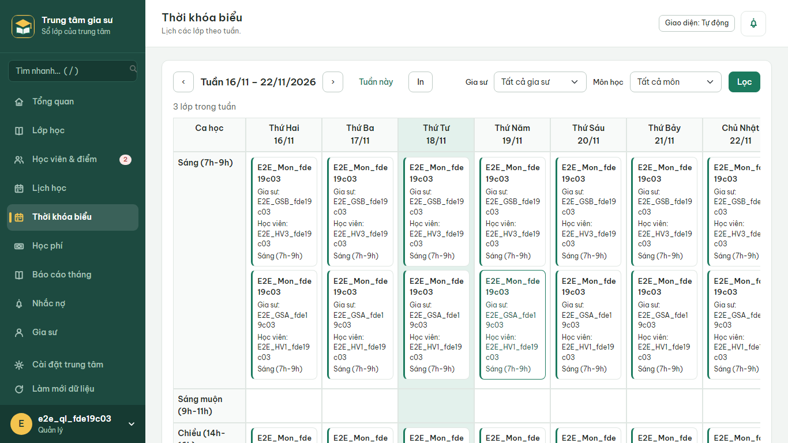

**Thời khóa biểu** hiển thị tuần theo ngày và ca. Dùng **Tuần trước / Tuần sau / Tuần này**, lọc theo gia sư hoặc môn, chọn **In** nếu cần bản giấy. Trên điện thoại lịch chuyển sang các thẻ theo ngày. Gia sư chỉ xem lịch của mình; quản lý có thể xem tất cả hoặc chọn một gia sư.

### Điểm danh

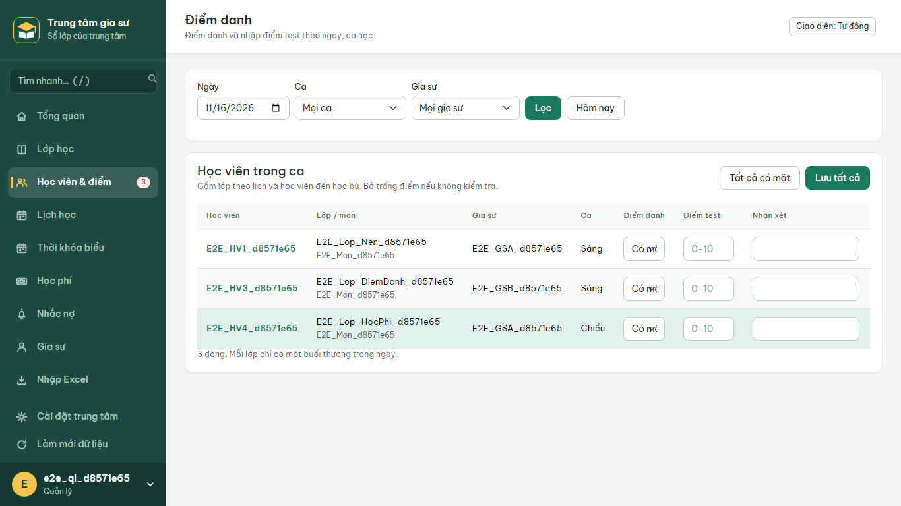

**Dùng để:** ghi trạng thái có mặt và kết quả học tập từng buổi.

**Cách dùng:** mở **Điểm danh**, chọn ngày, ca (quản lý có thể chọn thêm gia sư), chọn trạng thái cho từng học viên; có thể bấm **Tất cả có mặt** nếu phù hợp. Điểm test và nhận xét không bắt buộc; chọn **Lưu tất cả**. Học viên trong buổi học bù cũng xuất hiện tại đây.

**Lưu ý:** không điểm danh ngày tương lai. Điểm test từ 0 đến 10; để trống nếu không kiểm tra; học viên vắng không có điểm. Buổi vắng đã xếp lịch bù cần hủy lịch bù trước khi đổi trạng thái. Với môn năng khiếu, có thể đánh dấu **Thi lên cấp** khi nhập điểm; đạt từ 8 điểm thì lên cấp.

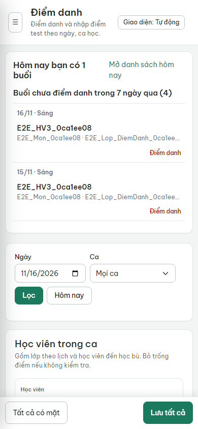

### Học phí và phiếu thu

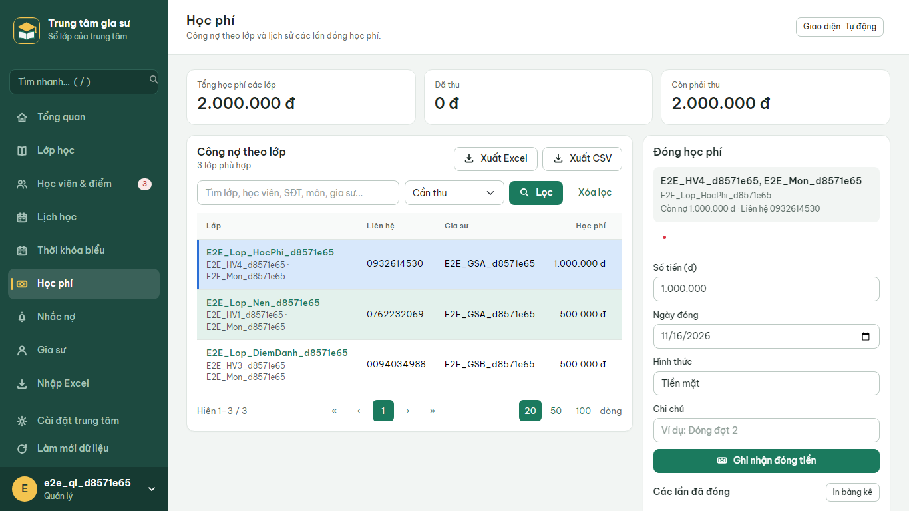

**Dùng để:** theo dõi tiền phải đóng, đã đóng, còn nợ và in phiếu thu.

**Cách dùng:** vào **Học phí**, tìm hoặc lọc tình trạng; chọn một lớp trong danh sách để xem lịch sử. Nhập số tiền, ngày đóng, hình thức thanh toán và ghi chú (nếu có), rồi chọn **Ghi nhận đóng tiền**. Ở lịch sử chọn **In phiếu thu** để mở bản in; **In bảng kê** in tổng hợp các lần đóng của lớp. Có thể xuất danh sách ra Excel hoặc CSV.

**Lưu ý:** số tiền phải lớn hơn 0, không vượt quá khoản còn nợ; ngày đóng không ở tương lai. Không ghi nhận tiền cho lớp đã hủy. Chỉ xóa lần đóng khi cần điều chỉnh, vì thao tác này làm số nợ tăng trở lại.

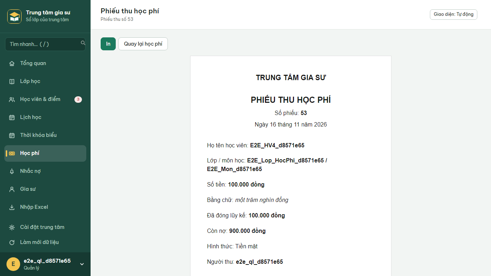

### Nhắc nợ

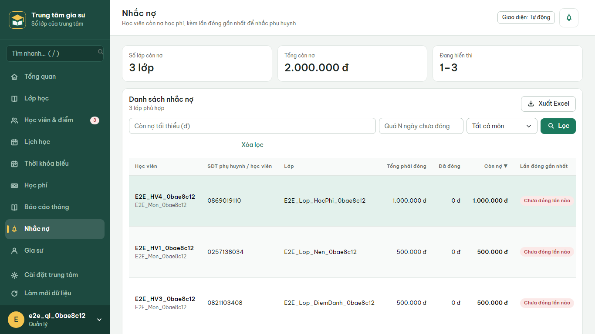

**Dùng để:** tìm lớp còn nợ và chuẩn bị nhắc phụ huynh.

**Cách dùng:** vào **Nhắc nợ**, lọc theo số tiền nợ tối thiểu, số ngày chưa đóng hoặc môn học; bấm tiêu đề cột để sắp xếp. Chọn **Sao chép tin nhắn** để sao chép nội dung nhắc nợ, sau đó tự gửi cho phụ huynh; chọn **Xuất Excel** nếu cần danh sách.

**Lưu ý:** màn hình chỉ tạo nội dung để sao chép, không tự gửi tin nhắn. Ngày chưa đóng được tính từ lần thanh toán gần nhất; lớp đã hủy không tính là khoản nợ.

### Nhật ký thao tác

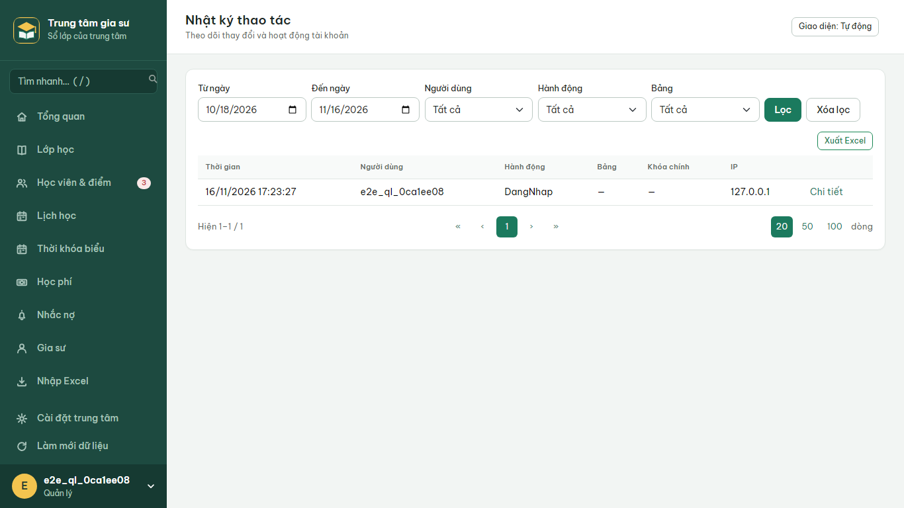

**Dùng để:** tra lại sự kiện đã được hệ thống ghi nhận.

**Cách dùng:** vào **Nhật ký thao tác**, lọc theo khoảng ngày, người dùng, hành động hoặc bảng dữ liệu; chọn **Chi tiết** để xem nội dung thay đổi, hoặc **Xuất Excel** để lưu danh sách.

**Lưu ý:** nhật ký chỉ xem được bởi quản lý. Danh sách phản ánh các thao tác ứng dụng có ghi nhật ký; không thay thế việc sao lưu CSDL.

### Nhập hồ sơ từ Excel

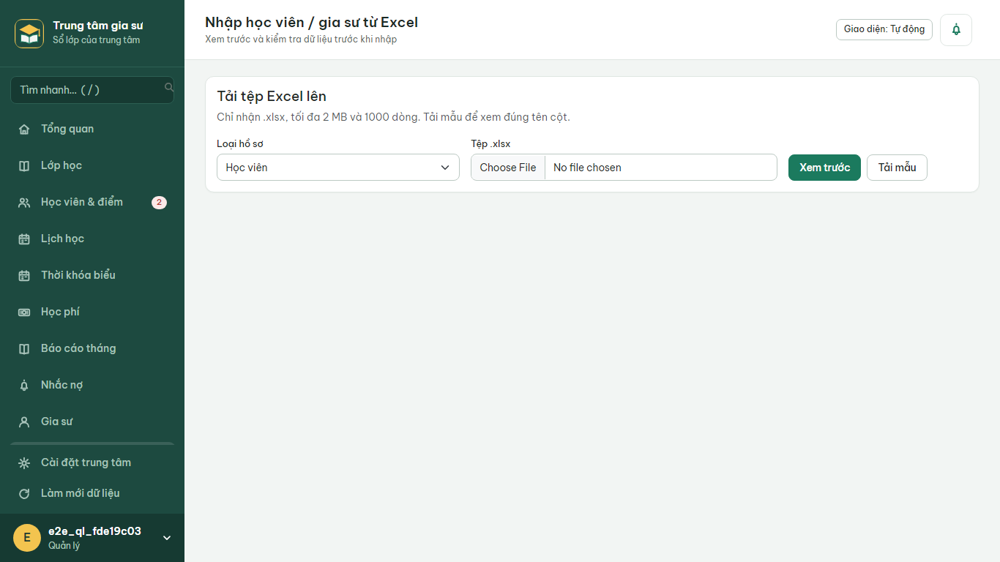

**Dùng để:** nhập danh sách học viên hoặc gia sư từ tệp `.xlsx`.

**Cách dùng:** vào **Nhập Excel**, chọn loại hồ sơ, tải đúng tệp mẫu, điền dữ liệu theo mẫu và tải lên. Chọn **Xem trước**, đọc trạng thái từng dòng và lý do lỗi; khi đã kiểm tra, chọn **Nhập các dòng hợp lệ**.

**Lưu ý:** chỉ nhận `.xlsx`, tối đa 2 MB và 1.000 dòng dữ liệu. Tên/thứ tự cột phải đúng mẫu. Dòng sai hoặc số điện thoại trùng sẽ không được nhập; hệ thống kiểm tra trùng lại khi lưu.

### Sao lưu CSDL

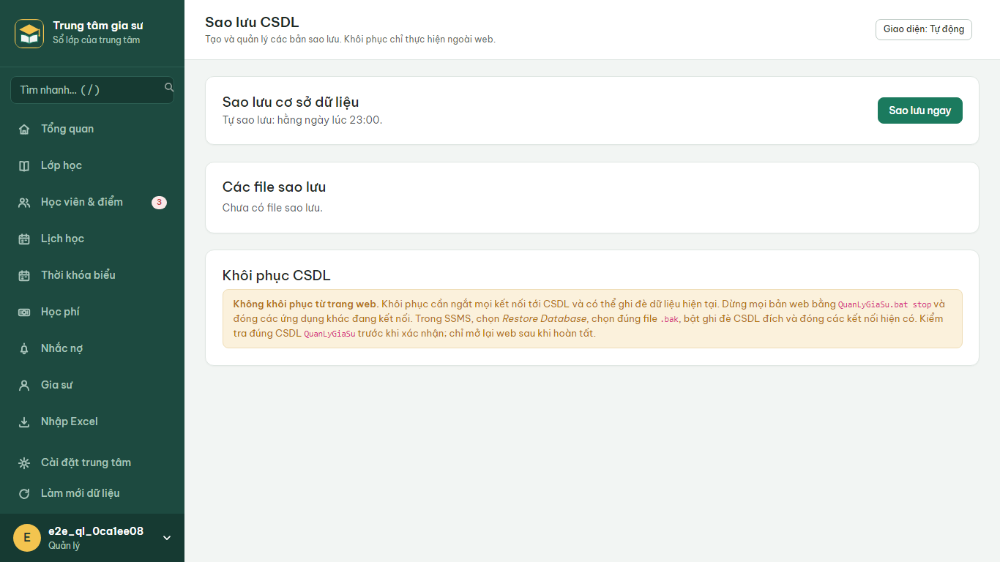

**Dùng để:** tạo và tải xuống bản sao lưu của CSDL mà web đang kết nối.

**Cách dùng:** vào **Sao lưu CSDL**, chọn **Sao lưu ngay** hoặc chờ lịch tự sao lưu hằng ngày; trong danh sách chọn **Tải về** để giữ bản `.bak`. Có thể xóa bản sao cũ không cần thiết.

**Lưu ý:** chỉ quản lý sử dụng được. SQL Server cần quyền ghi vào thư mục sao lưu. Trang web không khôi phục CSDL; khôi phục cần thực hiện ngoài web và phải chọn đúng CSDL đích. Web dùng `QuanLyGiaSu_Web`, không phải CSDL riêng `QuanLyGiaSu` của WinForms.

### Cài đặt trung tâm

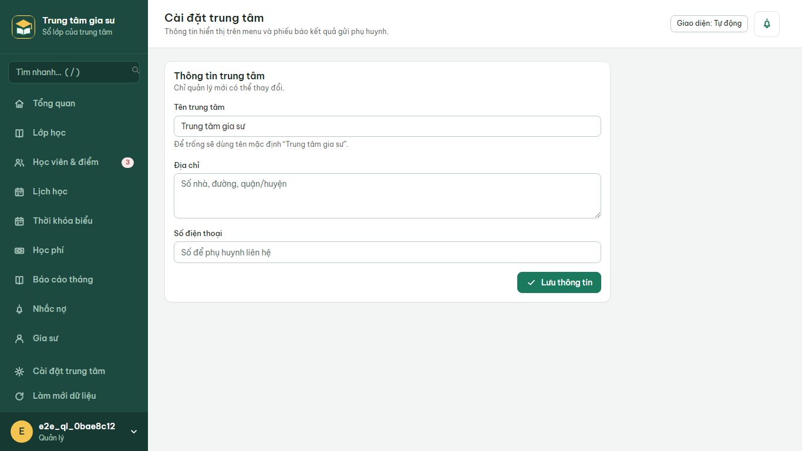

**Dùng để:** sửa tên, địa chỉ và số điện thoại trung tâm; tên được hiển thị trên trang và tài liệu in.

**Cách dùng:** vào **Cài đặt trung tâm**, điền thông tin cần thay đổi và chọn **Lưu thông tin**. Để trống tên thì dùng tên mặc định “Trung tâm gia sư”.

**Lưu ý:** chỉ quản lý được sửa; tên tối đa 100 ký tự, địa chỉ 300 ký tự, số điện thoại 50 ký tự.

## 3. Màn hình dành cho Gia sư

Sau khi đăng nhập, gia sư được đưa tới **Điểm danh**. Có thể xem các buổi hôm nay, các buổi chưa điểm danh trong 7 ngày qua, lọc ngày/ca và lưu điểm danh cho lớp mình dạy hoặc buổi bù mình phụ trách.

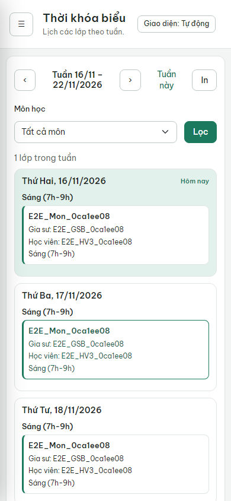

Trong **Học viên & điểm**, gia sư chỉ tra cứu học viên có lớp của mình hoặc buổi bù mình dạy, xem kết quả và lịch sử buổi học; không thêm, sửa hoặc xóa hồ sơ. **Lịch học** và **Thời khóa biểu** chỉ hiển thị lịch của gia sư đang đăng nhập. Các mục quản lý như Gia sư, Lớp học, Học phí, Nhắc nợ, Nhật ký, Nhập Excel, Sao lưu, Tài khoản và Cài đặt không cấp cho vai trò này.

## 4. Tìm nhanh, giao diện tối và dùng trên điện thoại

### Tìm kiếm nhanh bằng Ctrl+K

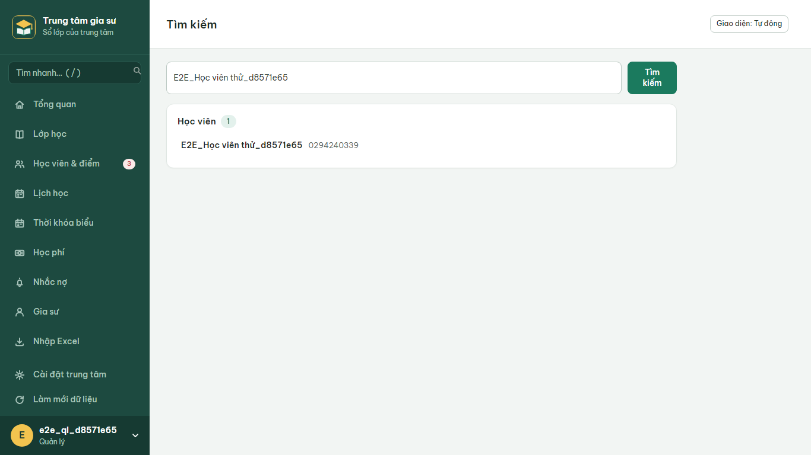

Ở màn hình đã đăng nhập, nhấn **Ctrl+K** (Mac: **⌘K**) hoặc phím **/** khi không nhập trong ô khác để mở ô **Tìm nhanh** trên thanh bên. Gõ ít nhất hai ký tự; có thể gõ không dấu. Dùng phím **↑ / ↓** chọn gợi ý, **Enter** mở mục, **Esc** đóng. Kết quả gồm học viên, gia sư (quản lý) và lớp học; gia sư chỉ tìm được các mục theo quyền của mình.

### Giao diện tối

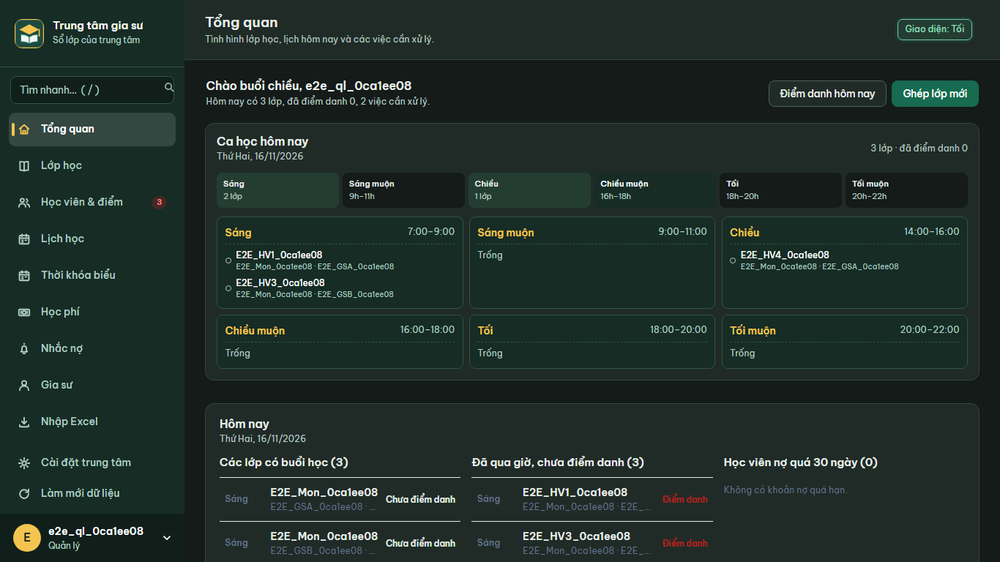

Nhấn nút **Giao diện: ...** ở góc trên để chuyển lần lượt giữa **Tự động**, **Sáng** và **Tối**. Lựa chọn được lưu trên trình duyệt đang dùng; chế độ tự động theo giao diện sáng/tối của thiết bị.

### Cài lên điện thoại (PWA)

1. Mở địa chỉ web của trung tâm trên điện thoại bằng trình duyệt hỗ trợ cài ứng dụng; để cài từ máy chủ trong mạng, địa chỉ cần dùng HTTPS.
2. Mở menu của trình duyệt, chọn **Cài đặt ứng dụng** hoặc **Thêm vào màn hình chính** (tên mục tùy trình duyệt), rồi xác nhận.
3. Mở biểu tượng **Quản lý gia sư** trên màn hình chính và đăng nhập như bình thường.

PWA mở giao diện gọn như ứng dụng và có thể hiện trang ngoại tuyến khi mất mạng. Dữ liệu học viên, lớp và thao tác ghi vẫn cần kết nối web; không nhập liệu khi thiết bị đang ngoại tuyến.

Khi truy cập từ xa, hãy kết nối điện thoại và máy chủ vào cùng tailnet Tailscale, rồi mở địa chỉ HTTPS do `QuanLyGiaSu.bat tu-xa` in ra; trên điện thoại chọn **Thêm vào màn hình chính** để cài PWA. Nếu dùng HTTPS, quản lý cần bật `BaoMat:BatBuocHttps` trong cấu hình Production sau khi kiểm tra HTTPS hoạt động, đồng thời đổi mật khẩu mặc định `admin` / `admin123` ngay lần đăng nhập đầu tiên.
